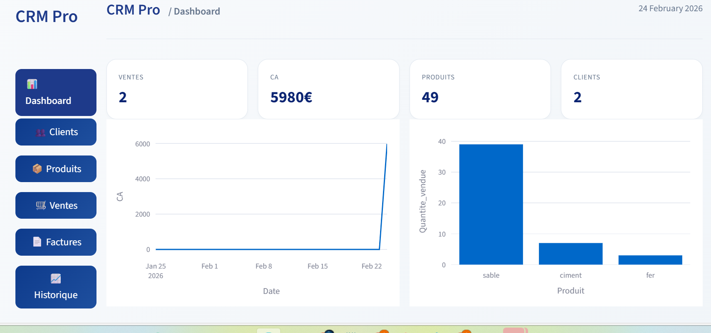
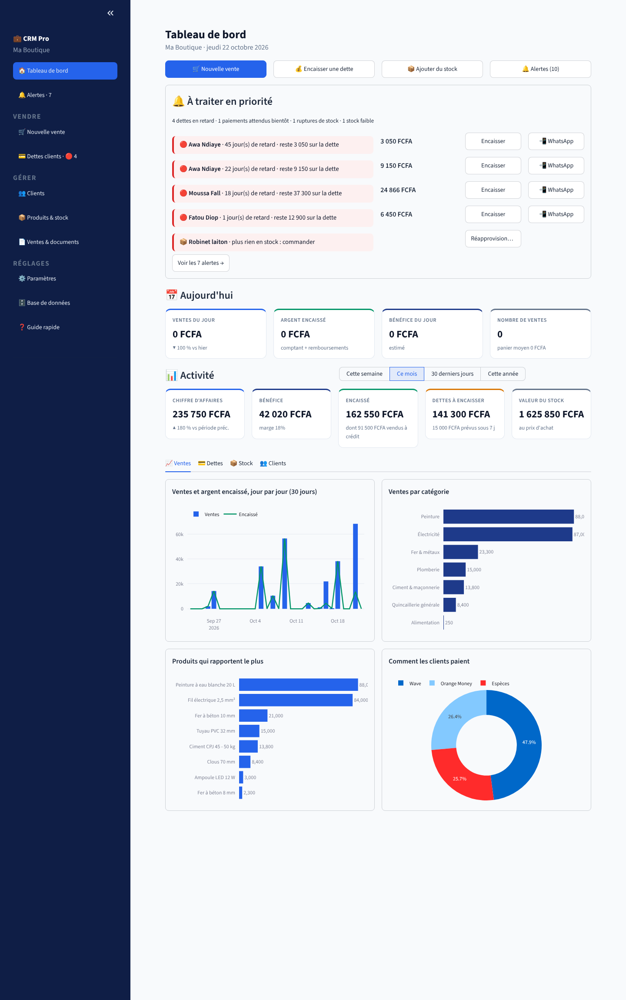
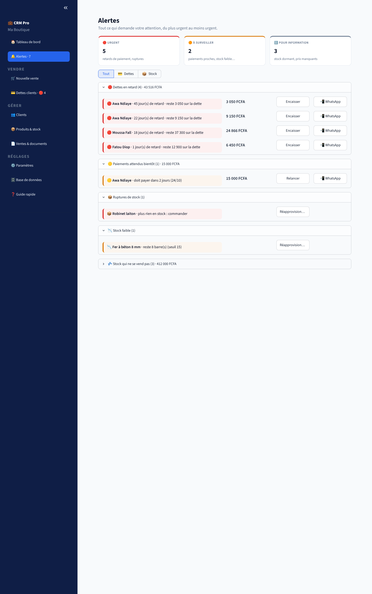
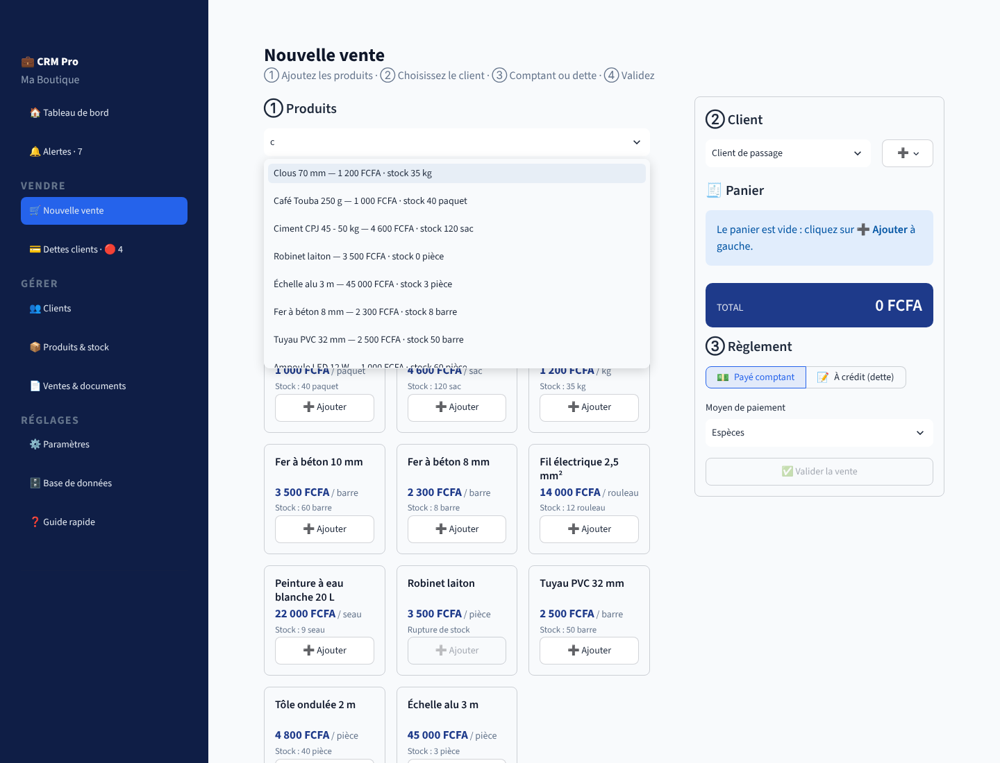
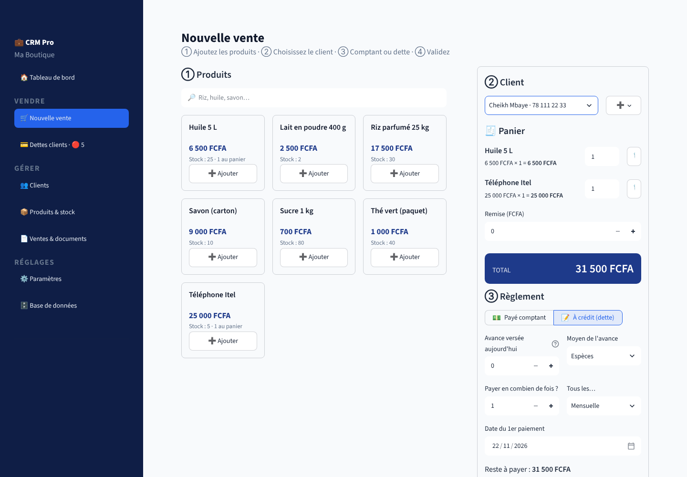
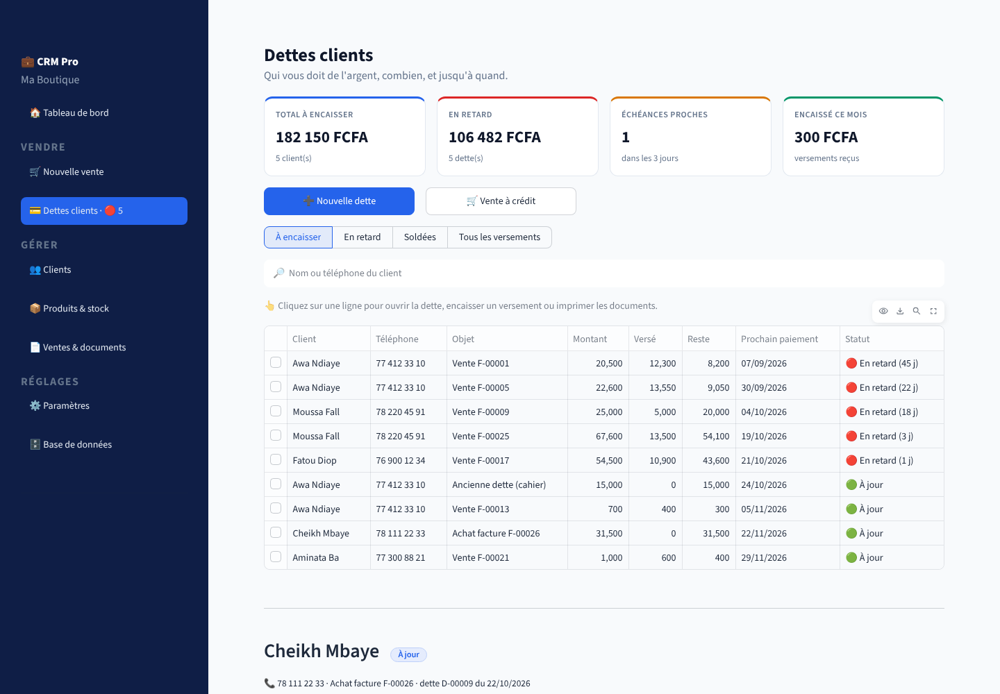
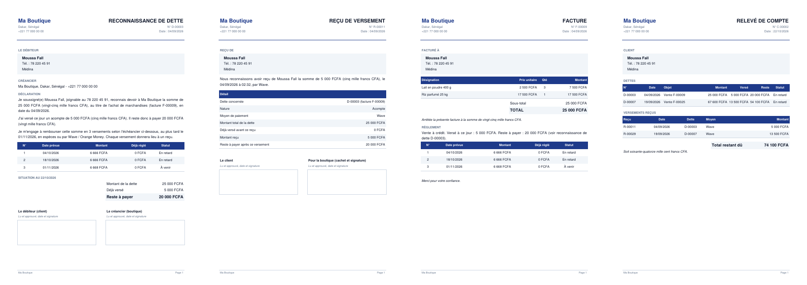

# 🚀 CRM PRO - Application de Gestion Commerciale & Données Clients


[](https://github.com/ABDOULAYEDIOP150/CRM/actions/workflows/ci.yml)

---

## 🎯 Aperçu

**CRM Pro** est une application de gestion commerciale et de pilotage des données clients, développée dans une logique proche des outils CRM professionnels (type Salesforce, Coheris).

L’objectif est de centraliser, structurer et exploiter les données clients afin d’améliorer le suivi commercial, la prise de décision et la performance globale.

👉 Ce projet s’inscrit dans une démarche de :

* structuration des données CRM
* pilotage d’activité commerciale
* support à la décision via indicateurs

---

## 📸 Capture d’écran



*Exemple : tableau de bord et interface de gestion (clients, produits, ventes)*

👉 L’application comporte plusieurs modules :

* Dashboard (indicateurs clés)
* Gestion des clients
* Gestion des produits
* Gestion des ventes
* Facturation

---

## 💡 Problématique métier

Dans de nombreuses organisations, les données clients sont :

* dispersées (Excel, outils multiples)
* peu structurées
* difficilement exploitables

👉 CRM Pro répond à ces enjeux en proposant :

* une base de données centralisée
* une vision 360° du client
* des indicateurs de performance en temps réel

---

## 🧠 Fonctionnalités principales

### 🛒 Caisse (nouvelle vente) — en 4 étapes
1. Taper les premières lettres d'un produit : **suggestions automatiques** depuis la base (« ci » → Ciment, « ca » → Café), ou parcourir le catalogue par catégorie
2. Choisir le client (ou « Client de passage », ou en créer un avec ➕)
3. **Payé comptant** ou **À crédit (dette)** : le choix est visible dès l'ouverture
   - comptant : moyen de paiement (Espèces, Wave, Orange Money…) et monnaie à rendre
   - dette : avance versée aujourd'hui, nombre de paiements, fréquence, date du 1er paiement, aperçu de l'échéancier
4. Valider → écran de confirmation avec les **documents à imprimer**

### 💳 Dettes clients
* Qui doit combien, jusqu'à quand : 🟢 À jour · 🔴 En retard (nombre de jours) · ✅ Soldée
* Clic sur une dette → **Encaisser un versement**, reçu immédiat, relance **WhatsApp**
* Dette sans vente (ancienne dette du cahier, argent prêté…), plafond de crédit par client
* Donner plus de temps (rééchelonnement), annulation

### 📄 Documents PDF (preuves écrites)
* **Reconnaissance de dette** à faire signer : montant en chiffres et **en lettres**, avance versée, échéancier, signatures
* **Reçu de versement** pour chaque avance ou remboursement (« déjà versé / reste à payer »)
* **Facture** avec situation de paiement, **relevé de compte client**

### 🏠 Tableau de bord (pensé pour une quincaillerie / boutique)
* **À traiter en priorité** : les alertes urgentes avec boutons Encaisser / WhatsApp / Commander
* **Aujourd'hui** : ventes du jour (vs hier), argent encaissé, bénéfice, nombre de ventes, caisse par moyen de paiement
* **Activité** (semaine / mois / année) : chiffre d'affaires, bénéfice et marge, encaissé, dettes, valeur du stock
* Onglets **Ventes** (par jour, par catégorie, produits qui rapportent), **Dettes** (ancienneté, top débiteurs, prévu sous 7 j), **Stock** (à commander, argent immobilisé par catégorie), **Clients** (meilleurs clients, nouveaux)

### 🔔 Alertes (page séparée)
* 🔴 Urgent : dettes en retard, ruptures de stock
* 🟠 À surveiller : client qui doit payer aujourd'hui ou **dans les 2 jours**, stock faible (seuil par produit), plafond de crédit dépassé, produit vendu sous son prix d'achat
* ℹ️ Information : stock qui ne se vend pas depuis 30 jours, prix d'achat manquants

### 👥 Clients · 📦 Produits · ❓ Guide rapide
* Fiche client : achats, dettes, versements, relevé
* Produits avec catégorie, unité (sac, barre, kg…), seuil d'alerte ; **réception de marchandise** ; modification dans le tableau
* **Import Excel / CSV** du catalogue (modèle fourni, colonnes reconnues automatiquement, aperçu avant import, mise à jour sans doublon) et export pour modifier dans Excel
* **Journal des mouvements de stock** : chaque vente, réception, correction et import est tracé
* **Police au choix** dans Paramètres (Inter, Poppins, Nunito, Montserrat, Roboto)
* Guide rapide intégré pour former un vendeur en 10 minutes

### 🗄️ Base de données
* SQLite en local, **PostgreSQL** en ligne (Neon / Supabase) ; tables créées et mises à jour automatiquement
* Page dédiée : type de base, nombre d'enregistrements, **export Excel complet** et sauvegarde du fichier

| Tableau de bord | Alertes | Recherche produit |
|---|---|---|
|  |  |  |

| Caisse | Dettes | Documents |
|---|---|---|
|  |  |  |

---

## 🏗️ Architecture & Structure du projet

```bash
CRM/
│── app_crm.py              # Application Streamlit (menu + routage)
│── config.py               # Paramètres, couleurs, formatage FCFA
│── demo_data.py            # Données de démonstration
│── .github/workflows/ci.yml # CI/CD
│── .streamlit/             # Thème + modèle de secrets
│── db/
│   ├── models.py           # Modèles SQLAlchemy + migration automatique de l'ancienne base
│   ├── dettes.py           # Logique métier des dettes (échéancier, retards, relances)
│   ├── lettres.py          # Montants en toutes lettres
│   └── utils.py            # Statistiques et paramètres
│── modules/                # pages (ventes, dettes, clients…), documents.py (PDF), auth.py : dashboard, clients, produits, ventes, dettes, factures, historique, parametres
│── tests/                  # Tests pytest (logique des dettes + chaque page)
│── static/styles.css
```

---

## 🧩 Modélisation des données

Le projet repose sur une structuration des données proche des CRM :

* **Clients** : informations personnelles, historique
* **Produits** : catalogue et stock
* **Ventes** : transactions liées aux clients
* **Factures** : documents générés
* **Dettes** → **Échéances** (plan de remboursement) et **Paiements** (tous les encaissements)

👉 Cette modélisation permet :

* une meilleure exploitation des données
* une analyse du parcours client
* une base pour marketing relationnel

---

## ⚙️ Technologies utilisées

* **Python** (logique applicative)
* **Streamlit** (interface utilisateur)
* **Pandas** (traitement des données)
* **SQLite + SQLAlchemy** (stockage des données)
* **fpdf2** (factures et reçus PDF)
* **Plotly** (graphiques)
* **pytest** (tests)

---

## 🔄 Logique projet (approche applicative)

Ce projet a été conçu dans une logique de :

* gestion d’un système applicatif CRM
* évolution progressive des fonctionnalités
* adaptation aux besoins métier
* amélioration continue

👉 Il simule le rôle de :
**Responsable applicatif / Data orienté CRM**

---

## 🚀 Installation

### Prérequis

* Python 3.8+
* pip

### Étapes

```bash
git clone https://github.com/ABDOULAYEDIOP150/CRM.git
cd CRM

python -m venv venv

# Activation
# Windows
venv\Scripts\activate
# Mac/Linux
source venv/bin/activate

pip install -r requirements.txt

python demo_data.py        # optionnel : données de démonstration
streamlit run app_crm.py
```

Une base créée avec une ancienne version est mise à jour automatiquement au lancement (aucune donnée perdue).

Lancer les tests : `python -m pytest -q`

---

## ☁️ Mise en ligne (Streamlit Community Cloud)

1. Aller sur [share.streamlit.io](https://share.streamlit.io) et se connecter avec GitHub
2. **Create app** → dépôt `ABDOULAYEDIOP150/CRM`, branche `main`, fichier `app_crm.py`
3. **Advanced settings → Secrets** : coller le contenu de `.streamlit/secrets.toml.example` en l'adaptant
   (`APP_PASSWORD` pour protéger l'accès, `DEMO_MODE` pour une démo, `[database] url` pour garder les données)
4. **Deploy** → l'app obtient un lien du type `https://crm-xxxx.streamlit.app`

> ⚠️ Sans base PostgreSQL, Streamlit Cloud efface la base SQLite à chaque redémarrage.
> Une base gratuite [Neon](https://neon.tech) ou [Supabase](https://supabase.com) suffit.

## 🔁 CI/CD (GitHub Actions)

À chaque push ou pull request (`.github/workflows/ci.yml`) :

| Étape | Rôle |
|---|---|
| **lint** | `ruff check` + `ruff format --check` |
| **tests** | `pytest` sur Python 3.11 et 3.12 (logique des dettes, chaque page, connexion) |
| **smoke** | démarre réellement le serveur Streamlit et vérifie `/_stcore/health` |
| **deploy-check** | après un push sur `main`, Streamlit Cloud redéploie tout seul ; ce job vérifie que l'URL en ligne répond (variable de dépôt `STREAMLIT_APP_URL`) |

Dependabot propose chaque mois la mise à jour des dépendances.

En local : `pip install -r requirements-dev.txt`, puis `ruff check . && python -m pytest -q`.

---

## ▶️ Utilisation

1. Accéder au tableau de bord
2. Ajouter des clients / produits
3. Enregistrer des ventes
4. Générer des factures
5. Analyser les performances

---

## 📈 Perspectives d’amélioration

* Comptes utilisateurs (gérant / vendeur) et journal des actions
* Envoi automatique des relances WhatsApp (API WhatsApp Business)
* Paiement Wave / Orange Money par lien ou QR code
* Mode hors-ligne / application mobile, multi-boutiques
* Intégration d’une base SQL (PostgreSQL / MySQL)
* Ajout d’API pour interconnexion (approche SI)
* Module de marketing automation (emailing)
* Gestion des utilisateurs / rôles
* Intégration RGPD (gestion consentement)

---

## 🤝 Contribution

Les contributions sont les bienvenues :

* amélioration des fonctionnalités
* optimisation technique
* ajout de modules CRM

---

## 📄 Licence

Projet sous licence MIT

---

## 📬 Contact

**Abdoulaye Diop**
📧 [diop.abdoulaye.stats@gmail.com](mailto:diop.abdoulaye.stats@gmail.com)
🔗 LinkedIn : https://www.linkedin.com/in/abdoulaye-diop-71467b361/

---
